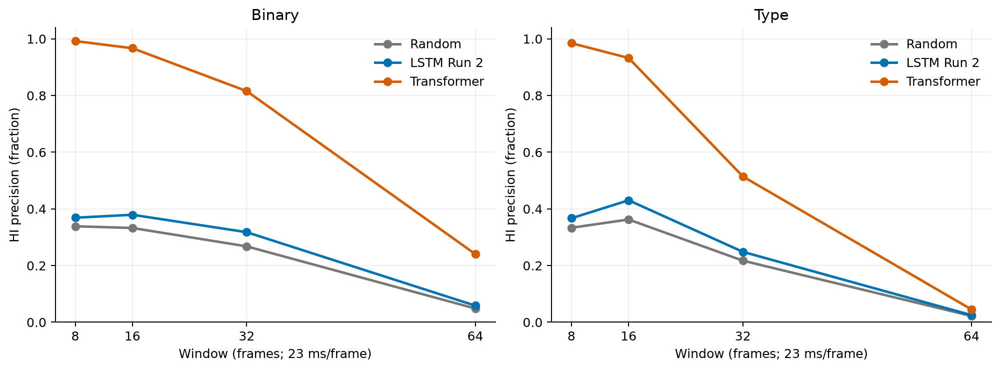
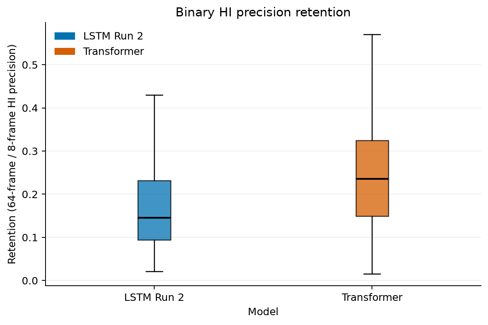
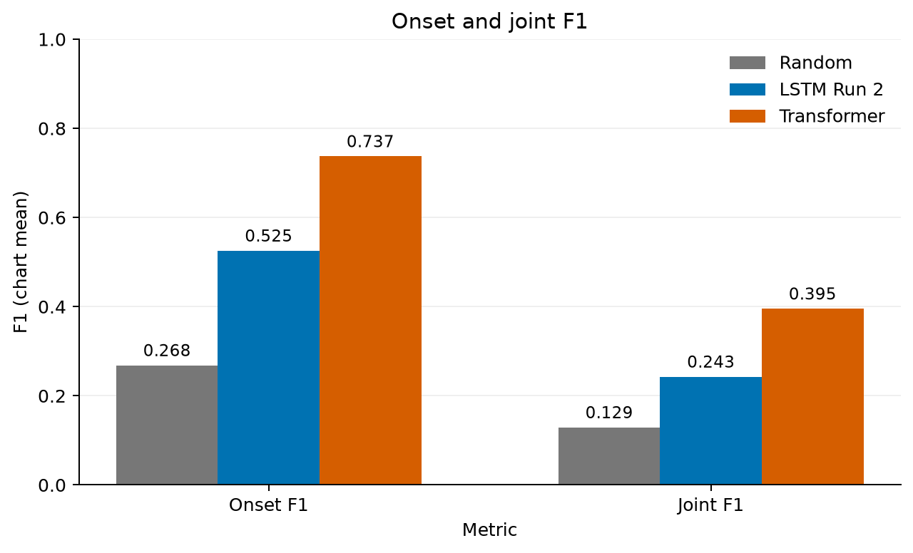
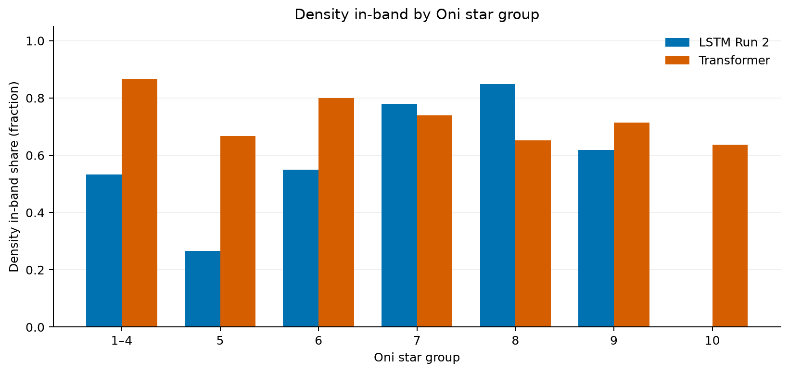

Sources: random baseline / LSTM Run 2 (20261029_120114-run2_a16_h12_f3-oni_v2-frame23ms) / Transformer (20261103_150750-base-oni_v2-frame23ms), oni_v2 test set, 178 charts, AR mode, raw.

## Primary paired test (binary retention, 64/8)

| Metric | Random | LSTM Run 2 | Transformer |
| --- | --- | --- | --- |
| n | - | 178.000 | 178.000 |
| Median retention | - | 0.145 | 0.236 |
| Wilcoxon statistic | - | 2478.000 | 2478.000 |
| p-value | - | 2.098e-17 | 2.098e-17 |

## Timing (chart means)

| Metric | Random | LSTM Run 2 | Transformer |
| --- | --- | --- | --- |
| Onset P | 0.268 | 0.522 | 0.717 |
| Onset R | 0.268 | 0.544 | 0.771 |
| Onset F1 | 0.268 | 0.525 | 0.737 |
| Joint P | 0.129 | 0.241 | 0.384 |
| Joint R | 0.129 | 0.251 | 0.414 |
| Joint F1 | 0.129 | 0.243 | 0.395 |

## HI precision

| Metric | Random | LSTM Run 2 | Transformer |
| --- | --- | --- | --- |
| Binary, 8 frames | 0.339 | 0.369 | 0.992 |
| Binary, 16 frames | 0.333 | 0.379 | 0.967 |
| Binary, 32 frames | 0.268 | 0.318 | 0.816 |
| Binary, 64 frames | 0.048 | 0.059 | 0.240 |
| Type, 8 frames | 0.333 | 0.367 | 0.985 |
| Type, 16 frames | 0.363 | 0.430 | 0.932 |
| Type, 32 frames | 0.217 | 0.248 | 0.514 |
| Type, 64 frames | 0.022 | 0.025 | 0.045 |

## Overall ratio

| Metric | Random | LSTM Run 2 | Transformer |
| --- | --- | --- | --- |
| Binary, 8 frames | 5.681 | 5.320 | 1.108 |
| Binary, 16 frames | 7.595 | 7.512 | 1.233 |
| Binary, 32 frames | 4.154 | 4.273 | 1.296 |
| Binary, 64 frames | 1.646 | 1.626 | 1.227 |
| Type, 8 frames | 5.059 | 4.627 | 0.982 |
| Type, 16 frames | 3.617 | 3.820 | 1.087 |
| Type, 32 frames | 1.899 | 2.008 | 1.202 |
| Type, 64 frames | 1.307 | 1.286 | 1.157 |

## Difficulty (density: starts/s; in-band: fraction)

| Metric | Random | LSTM Run 2 | Transformer |
| --- | --- | --- | --- |
| Density mean | - | 4.615 | 4.948 |
| Density in-band | - | 0.640 | 0.719 |
| Don/Ka mean | 1.383 | 1.360 | 1.553 |
| Don/Ka in-band | 1.000 | 0.978 | 0.792 |

## Per Oni star group (chart means)

| Oni stars | Metric | LSTM Run 2 | Transformer |
| --- | --- | --- | --- |
| 1–4 | Test charts | 15.000 | 15.000 |
| 1–4 | Onset F1 | 0.463 | 0.694 |
| 1–4 | Joint F1 | 0.214 | 0.371 |
| 1–4 | Binary HI precision, 32 frames | 0.242 | 0.741 |
| 1–4 | Density in-band | 0.533 | 0.867 |
| 5 | Test charts | 15.000 | 15.000 |
| 5 | Onset F1 | 0.458 | 0.690 |
| 5 | Joint F1 | 0.203 | 0.378 |
| 5 | Binary HI precision, 32 frames | 0.259 | 0.769 |
| 5 | Density in-band | 0.267 | 0.667 |
| 6 | Test charts | 20.000 | 20.000 |
| 6 | Onset F1 | 0.521 | 0.745 |
| 6 | Joint F1 | 0.234 | 0.407 |
| 6 | Binary HI precision, 32 frames | 0.278 | 0.824 |
| 6 | Density in-band | 0.550 | 0.800 |
| 7 | Test charts | 50.000 | 50.000 |
| 7 | Onset F1 | 0.528 | 0.740 |
| 7 | Joint F1 | 0.243 | 0.389 |
| 7 | Binary HI precision, 32 frames | 0.350 | 0.875 |
| 7 | Density in-band | 0.780 | 0.740 |
| 8 | Test charts | 46.000 | 46.000 |
| 8 | Onset F1 | 0.551 | 0.751 |
| 8 | Joint F1 | 0.258 | 0.405 |
| 8 | Binary HI precision, 32 frames | 0.353 | 0.867 |
| 8 | Density in-band | 0.848 | 0.652 |
| 9 | Test charts | 21.000 | 21.000 |
| 9 | Onset F1 | 0.552 | 0.752 |
| 9 | Joint F1 | 0.261 | 0.414 |
| 9 | Binary HI precision, 32 frames | 0.338 | 0.780 |
| 9 | Density in-band | 0.619 | 0.714 |
| 10 | Test charts | 11.000 | 11.000 |
| 10 | Onset F1 | 0.541 | 0.748 |
| 10 | Joint F1 | 0.251 | 0.377 |
| 10 | Binary HI precision, 32 frames | 0.244 | 0.550 |
| 10 | Density in-band | 0.000 | 0.636 |

## Paired secondary tests (significant / eligible, Holm)

| Oni stars | Random | LSTM Run 2 | Transformer |
| --- | --- | --- | --- |
| Overall | - | 40.000 / 44.000 | 40.000 / 44.000 |
| 1–4 | - | 34.000 / 45.000 | 34.000 / 45.000 |
| 5 | - | 32.000 / 45.000 | 32.000 / 45.000 |
| 6 | - | 34.000 / 45.000 | 34.000 / 45.000 |
| 7 | - | 36.000 / 45.000 | 36.000 / 45.000 |
| 8 | - | 38.000 / 45.000 | 38.000 / 45.000 |
| 9 | - | 34.000 / 45.000 | 34.000 / 45.000 |
| 10 | - | 0.000 / 45.000 | 0.000 / 45.000 |

## HI precision vs. window

## Per-chart binary retention

## Onset and joint F1

## Density in-band by Oni star group

